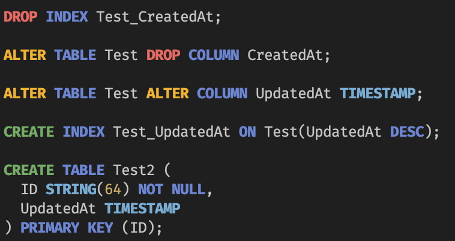

# spannerdiff

Schema migration tool for Cloud Spanner.

Note: This tool is currently under development. The interface may change.

## Installation

```sh
$ brew install morikuni/tap/spannerdiff 
```

## Supported DDL

- `CREATE SCHEMA`
- `CREATE TABLE`
- `CREATE INDEX`
- `CREATE SEARCH INDEX`
- `CREATE PROPERTY GRAPH`
- `CREATE VIEW`
- `CREATE CHANGE STREAM`
- `CREATE SEQUENCE`
- `CREATE VECTOR INDEX`
- `CREATE MODEL`
- `CREATE PROTO BUNDLE`
- `CREATE QUEUE`
- `CREATE ROLE`
- `GRANT`
- `ALTER DATABASE`
- `ALTER TABLE ... ADD [CONSTRAINT name] {FOREIGN KEY | CHECK}`

## Colored Output



## Example

```sh
$ gcloud spanner databases ddl describe test
```

```sql
CREATE TABLE Test (
    ID STRING(64) NOT NULL,
    Name STRING(64) NOT NULL,
) PRIMARY KEY (ID);

CREATE INDEX Test_Name ON Test (Name);
```

```sh
$ cat schema.sql
```

```sql
CREATE TABLE Test (
    ID STRING(64) NOT NULL,
    Name STRING(64) NOT NULL,
    CreatedAt TIMESTAMP NOT NULL DEFAULT (CURRENT_TIMESTAMP()),
) PRIMARY KEY (ID);

CREATE INDEX Test_Name_CreatedAt ON Test (Name, CreatedAt DESC);
```

```sh
$ gcloud spanner databases ddl describe test | spannerdiff --base-stdin --target-file=schema.sql | tee tmp.sql
```

```sql
DROP INDEX Test_Name;

ALTER TABLE Test ADD COLUMN CreatedAt TIMESTAMP NOT NULL DEFAULT (CURRENT_TIMESTAMP());

CREATE INDEX Test_Name_CreatedAt ON Test(Name, CreatedAt DESC);
```

```sh
$ gcloud spanner databases ddl update test --ddl-file=tmp.sql
Schema updating...done.
```

## Unsupported DDL

DDL statements that are not listed in [Supported DDL](#supported-ddl) are ignored with a warning.
Use `--error-on-unsupported-ddl` to exit with an error instead.

## Adding NOT NULL Columns

Spanner can't add a `NOT NULL` column without a default value to an existing table, even if the table is empty.
spannerdiff exits with an error for such a column instead of generating DDL that Spanner rejects.
This also applies when spannerdiff recreates such a column, e.g. to change its type.
Add the column with a default value or as a nullable column first, so that you decide the values of existing rows.
Use `--zero-default-for-not-null-columns` to add such a column with the zero value of its type (e.g. `0`, `''`) as a temporary default value.
Existing rows get the zero value, so make sure that it is valid for the column, e.g. for a `CHECK` constraint, a unique index or a foreign key on the column.
With the option, spannerdiff still reports the error for `PROTO` and `ENUM` columns, because spannerdiff can't tell a proto from an enum without the proto descriptors, and `0` isn't always a valid enum value.

## Foreign Keys

A constraint is compared in the same way whether it's written in `CREATE TABLE` or added by `ALTER TABLE ... ADD`.
spannerdiff adds a foreign key referencing another table by `ALTER TABLE ... ADD` after creating the tables, instead of in `CREATE TABLE`, so that tables referencing each other can be created.
Other constraints are added in `CREATE TABLE` when the table is created.

## Known Issues & Limitations

- View DDL generation may be incorrect or out of order due to unresolved column names in the view query.
- Changes that can't be done by `ALTER` statements are migrated by dropping and recreating the object (e.g. changing the type of a column, or the primary key of a table). This deletes the data in it, so review the generated DDL before applying it.
- Changing `HIDDEN` of a column fails unless the column is generated, because Spanner can't alter `HIDDEN` and recreating the column would delete its data. A generated column is recreated.
- An unnamed constraint in the base schema can't be dropped. Spanner names unnamed constraints, so use the schema returned by Spanner (e.g. `gcloud spanner databases ddl describe`) as the base schema.
  However, Spanner may return unnamed foreign keys as `ALTER TABLE ... ADD FOREIGN KEY` without their names. These foreign keys can't be dropped either, except by dropping their table.
- Dropping tables whose unnamed foreign keys reference each other fails with `dependency cycle detected`, because neither foreign key can be dropped before the tables.
